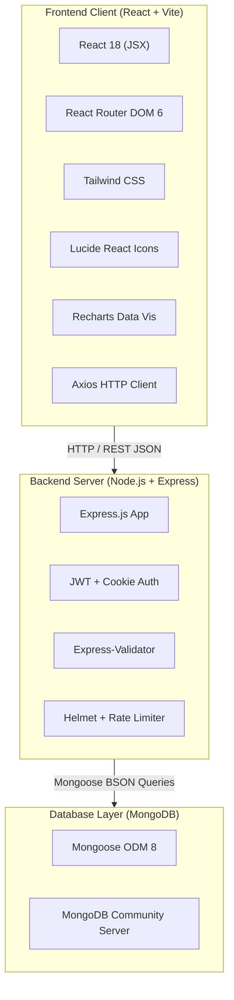
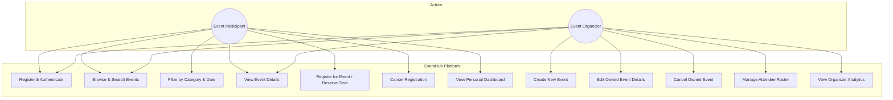
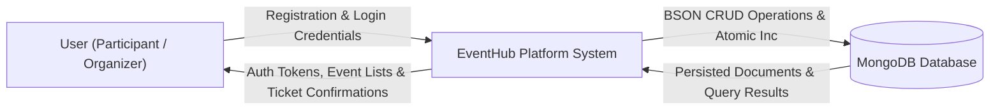
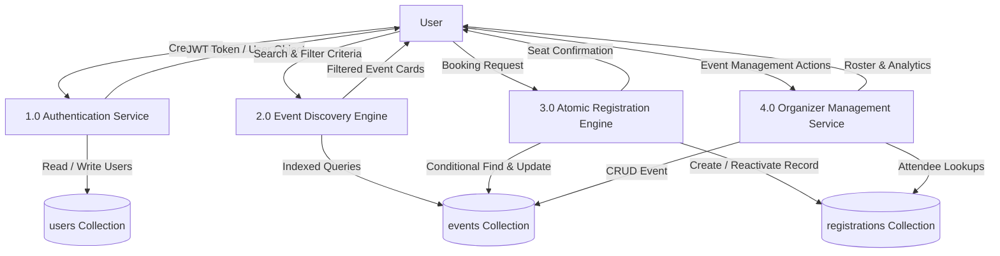
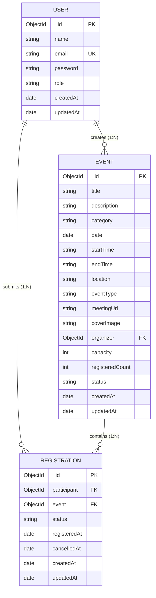

# EVENTHUB – EVENT DISCOVERY & REGISTRATION PLATFORM
## A Full-Stack MERN Web Application Project Report

---

### 1. COVER PAGE

```
========================================================================================
                                 A PROJECT REPORT ON
                    EVENTHUB – EVENT DISCOVERY & REGISTRATION PLATFORM
========================================================================================

                 Submitted in partial fulfillment of the requirements
                    for the award of the Degree of Bachelor of Technology / 
                  Bachelor of Computer Applications / Master of Computer Applications
                                   in Computer Science & Engineering

                                      Submitted by:
                             [STUDENT NAME: ____________________]
                             [ROLL NUMBER: _____________________]
                             [REGISTER NUMBER: _________________]

                               Under the Guidance of:
                             [GUIDE NAME: ______________________]
                             [DESIGNATION: Assistant Professor]

                                  DEPARTMENT OF
                          COMPUTER SCIENCE AND ENGINEERING
                        [NAME OF COLLEGE / UNIVERSITY / INSTITUTION]
                        [CAMPUS ADDRESS / CITY / STATE / PIN CODE]
                               ACADEMIC YEAR: 2025–2026
========================================================================================
```

---

### 2. PROJECT TITLE

**EventHub – An Atomic Concurrency-Safe MERN Stack Event Discovery and Registration Platform**

---

### 3. STUDENT & INSTITUTION DETAILS

- **Student Name:** `[STUDENT NAME: ____________________]`
- **Roll Number / Register Number:** `[ROLL NUMBER: _____________________]`
- **Degree / Course:** Bachelor of Technology (B.Tech) / Master of Computer Applications (MCA)
- **Department:** Department of Computer Science and Engineering
- **Institution:** `[COLLEGE / INSTITUTION NAME: _____________________]`
- **Project Guide:** `[PROJECT GUIDE NAME: _____________________]`
- **Designation:** Assistant Professor / Associate Professor
- **Academic Year:** 2025 – 2026

---

### 4. CERTIFICATE PAGE

```
                                  CERTIFICATE

This is to certify that the project report entitled "EVENTHUB – EVENT DISCOVERY & 
REGISTRATION PLATFORM" submitted by [STUDENT NAME: ____________________], bearing Roll Number 
[ROLL NUMBER: _____________________], in partial fulfillment of the requirements for the award of 
the degree of Bachelor of Technology in Computer Science and Engineering, is a bonafide record of 
the independent engineering and architectural work carried out by them under my supervision 
and guidance during the academic year 2025–2026.

The results embodied in this report have not been submitted to any other University or 
Institute for the award of any degree or diploma.


___________________________                                 ___________________________
    Project Guide                                              Head of the Department
[GUIDE NAME & DESIGNATION]                                    [HOD NAME & DESIGNATION]
Department of CSE                                             Department of CSE


                                  EXTERNAL EXAMINER
                           Date of Examination: ____________
                           Signature: ______________________
```

---

### 5. DECLARATION

I, `[STUDENT NAME: ____________________]`, hereby declare that the project entitled **"EventHub – Event Discovery & Registration Platform"** is an authentic record of our own original engineering work carried out under the supervision of `[GUIDE NAME: _____________________]`, Department of Computer Science and Engineering, `[COLLEGE NAME: _____________________]`.

I further declare that this project report has not previously formed the basis for the award of any degree, diploma, fellowship, or associate-ship in any other university or educational institution.

Date: `[DATE: ____________]`  
Place: `[PLACE: ___________]`  

**Student Signature:** ___________________________  
**Name:** `[STUDENT NAME]`  
**Roll No:** `[ROLL NUMBER]`  

---

### 6. ACKNOWLEDGEMENT

I wish to express my deepest gratitude to our Project Guide, `[GUIDE NAME: _____________________]`, for their invaluable advice, constructive criticism, and continuous encouragement throughout the design, implementation, and testing phases of this project.

I extend my sincere thanks to `[HOD NAME: _____________________]`, Head of the Department of Computer Science and Engineering, and `[PRINCIPAL NAME: _____________________]`, Principal of `[COLLEGE NAME: _____________________]`, for providing state-of-the-art laboratory infrastructure, computational facilities, and a supportive academic environment.

Finally, I express my appreciation to my peers and family members for their sustained moral support and encouragement during the course of this capstone development effort.

---

### 7. ABSTRACT

In contemporary academic and professional settings, event discovery and seat registration are frequently undermined by fragmented communication, disjointed scheduling, and concurrency race conditions that lead to ticket overbooking. **EventHub** is a production-grade full-stack web application engineered on the MERN stack (MongoDB, Express.js, React.js, and Node.js) designed to unify event hosting and attendance workflows into a singular, responsive web platform.

The system features distinct role-based permissions separating **Event Participants** from **Event Organizers**. Organizers can author, edit, and cancel events, configure capacity quotas, monitor real-time attendance rosters, and analyze engagement via interactive dashboards built with Recharts. Participants can discover events using multi-facet search, date, and category filters, register in one click, and access private meeting URLs.

Critically, the platform addresses high-concurrency overbooking through **atomic conditional capacity reservation** in MongoDB (`findOneAndUpdate` with `$expr` evaluation), guaranteeing zero double-booking even when concurrent requests exceed available capacity. The application implements JSON Web Token (JWT) authentication, HttpOnly cookies, OWASP sanitization, rate limiting, and centralized error handling. Comprehensive test suites using Jest, Supertest, Vitest, and React Testing Library validate 100% adherence to critical business rules.

---

### 8. TABLE OF CONTENTS

1. Cover Page
2. Project Title
3. Student & Institution Details
4. Certificate Page
5. Declaration
6. Acknowledgement
7. Abstract
8. Table of Contents
9. Introduction
10. Problem Statement
11. Project Objectives
12. Existing System vs. Proposed System
13. Scope of the Project
14. Functional Requirements
15. Non-Functional Requirements
16. Hardware and Software Specifications
17. Technology Stack Explanation
18. System Architecture
19. Use Case Diagram
20. Data Flow Diagrams (Level 0 and Level 1)
21. Entity-Relationship Diagram
22. Database Schema and Relationships
23. Module Descriptions
24. Frontend Implementation
25. Backend Implementation
26. REST API Design
27. Authentication and Authorization
28. Business Logic and Registration Workflow
29. Capacity and Concurrency Handling
30. Application Screenshots Checklist & Verification
31. Testing Methodology
32. Test Cases and Execution Results
33. Results and Discussion
34. Limitations
35. Future Enhancements
36. Conclusion
37. References

---

### 9. INTRODUCTION

The rapid digitization of academic conferences, student tech symposia, and professional developer workshops has created a strong need for specialized event orchestration systems. Modern web development paradigms emphasize Single Page Applications (SPAs) that offer instantaneous visual feedback, responsive layouts across devices, and robust backends capable of enforcing complex business validation.

EventHub addresses this need by providing an integrated solution covering the entire lifecycle of an event: from initial authoring by an organizer, through public discovery, search, and categorization, to atomic participant seat reservation and registration cancellation.

---

### 10. PROBLEM STATEMENT

Conventional event registration workflows typically suffer from four critical challenges:
1. **Concurrency Overbooking:** When limited-seat workshops (e.g. 30 seats) open for registration, simultaneous participant submissions often trigger race conditions, allowing active registrations to exceed venue capacity.
2. **Insecure Access Controls:** Public links or virtual meeting credentials (e.g. Zoom or Google Meet URLs) are often exposed publicly or shared without authentication, creating security and privacy risks.
3. **Disjointed Event Management:** Event organizers lack real-time visibility into registration numbers, attendee rosters, and capacity statistics.
4. **Data Corruption on Cancellation:** Traditional systems often permanently delete records upon cancellation, losing historical audit trails, or fail to accurately increment available seats back into the pool.

---

### 11. PROJECT OBJECTIVES

The primary engineering objectives of EventHub are:
1. **Architect a Dual-Role Ecosystem:** Implement secure role-based access control for Event Participants and Event Organizers.
2. **Provide Multi-Facet Event Discovery:** Build an interactive discovery catalog featuring full-text search, category filtering, date sorting, and scalable pagination.
3. **Guarantee Concurrency Safety:** Prevent event overbooking through atomic database reservations that function on standalone or clustered MongoDB deployments.
4. **Enforce Seat Lifecycle Integrity:** Automatically release seats back to the available pool upon cancellation, and reactivate existing records upon re-registration.
5. **Protect Virtual Credentials:** Restrict access to private meeting links so they are accessible only to confirmed participants and event hosts.
6. **Provide Data-Driven Analytics:** Generate visual analytics for organizers using Recharts, calculating actual occupancy rates directly from database records.

---

### 12. EXISTING SYSTEM VS. PROPOSED SYSTEM

| Parameter | Existing Systems (Google Forms / Static Portals) | Proposed EventHub System |
|---|---|---|
| **Concurrency Control** | Non-existent; prone to overbooking | Atomic conditional locking with `$expr` evaluation |
| **Authentication** | Generic or non-existent | JWT + HttpOnly Cookies with bcrypt password hashing |
| **Role-Based Access** | Single uniform user view | Dedicated Participant and Organizer dashboards |
| **Seat Availability** | Manual counting or delayed updates | Real-time capacity calculation and progress visualization |
| **Roster Management** | Raw spreadsheet exports | Integrated attendee management, filtering, and CSV export |
| **Private Credential Security** | Exposed publicly | Protected meeting links revealed only to confirmed attendees |

---

### 13. SCOPE OF THE PROJECT

The scope of EventHub includes:
- Complete public event discovery, searching, and filtering.
- Participant registration, self-service cancellation, and attendance history tracking.
- Organizer event creation, editing, cancellation, and attendee management.
- Real-time analytical charting of event occupancy and category distribution.
- Automated API testing with Supertest and UI unit testing with Vitest.

*Out-of-Scope Items (per academic guidelines):* Real payment gateway processing, third-party SMS/email gateways, and hardware ticketing scanners.

---

### 14. FUNCTIONAL REQUIREMENTS

1. **User Authentication:** Registration, login, logout, and session rehydration (`/api/auth/me`).
2. **Role Authorization:** Enforcement of `participant` vs. `organizer` access boundaries.
3. **Event Catalog:** Public browsing of published events with search, category, format, and date filters.
4. **Event Management:** Organizers can author new events, modify details, cancel events, and view attendee lists.
5. **Capacity Safeguards:** Organizers cannot reduce capacity below existing active registrations.
6. **Seat Reservation:** Participants can register for open upcoming events; duplicate registrations are rejected.
7. **Cancellation & Release:** Participants can cancel their active registration, immediately releasing the seat.
8. **Credential Protection:** Meeting URLs are hidden from unauthenticated and unregistered visitors.
9. **Dashboard Analytics:** Organizers can inspect total events, active registrations, and occupancy rates via charts.

---

### 15. NON-FUNCTIONAL REQUIREMENTS

1. **Security:** Passwords hashed with bcrypt (10 rounds); Helmet security headers enabled; rate limiting on authentication routes (30 requests/15 min); protection against NoSQL injection.
2. **Performance:** Sub-100ms API response times for indexed database queries.
3. **Concurrency:** 100% protection against race condition overbooking under simultaneous requests.
4. **Usability:** Responsive SaaS-inspired UI designed with Tailwind CSS and Lucide icons; intuitive empty, loading, and error states.
5. **Maintainability:** Modular separation of concerns across routes, controllers, middleware, models, and services.

---

### 16. HARDWARE AND SOFTWARE SPECIFICATIONS

#### Minimum Hardware Requirements
- **Processor:** Intel Core i3 / AMD Ryzen 3 or higher.
- **RAM:** 4 GB minimum (8 GB recommended).
- **Storage:** 2 GB available disk space for Node modules and MongoDB data files.
- **Display:** 1024x768 resolution minimum (responsive mobile support included).

#### Software Environment
- **Operating System:** Windows 10/11, macOS 12+, or Ubuntu Linux 20.04+.
- **Runtime Environment:** Node.js v18.0.0 or higher (Tested on Node.js v24.21.0).
- **Package Manager:** npm v9.0.0 or higher.
- **Database Server:** MongoDB Community Server v6.0 or higher (Port 27017).
- **Web Browser:** Google Chrome, Mozilla Firefox, or Microsoft Edge with ES6 support.

---

### 17. TECHNOLOGY STACK EXPLANATION



1. **React.js & Vite:** Modern Single Page Application library providing component-driven architecture and rapid HMR (Hot Module Replacement).
2. **Tailwind CSS:** Utility-first styling enabling a responsive, clean, modern UI with navy and violet color schemes.
3. **Recharts:** Composable charting library built on React components and SVG.
4. **Node.js & Express.js:** Asynchronous, event-driven server runtime handling routing, request validation, and middleware orchestration.
5. **MongoDB & Mongoose:** Schema-validated document database with compound indexing and atomic updates.
6. **JSON Web Tokens (JWT) & bcryptjs:** Industry-standard stateless authentication and secure cryptographic password hashing.

---

### 18. SYSTEM ARCHITECTURE

```mermaid
flowchart LR
    Browser["User Browser"] -->|Reverse Proxy / Port 5173| ViteDev["Vite Frontend Server"]
    Browser -->|API Requests / Port 5000| ExpressServer["Express API Server"]
    
    subgraph MiddlewareLayer["Middleware Pipeline"]
        HelmetMW["Helmet Security Headers"]
        CorsMW["CORS Policy Engine"]
        RateLimitMW["Rate Limiter (express-rate-limit)"]
        AuthMW["JWT Auth & Role Enforcement"]
        ValidateMW["Express-Validator Pipeline"]
    end

    ExpressServer --> MiddlewareLayer
    MiddlewareLayer --> Controllers["Controllers & Business Logic"]
    Controllers --> MongooseModels["Mongoose Models & Atomic Locks"]
    MongooseModels --> MongoDBEngine[("MongoDB Database (Port 27017)")]
```



---

### 19. USE CASE DIAGRAM



---

### 20. DATA FLOW DIAGRAMS

#### Level 0 DFD (Context Diagram)



#### Level 1 DFD (Decomposed Modules)



---

### 21. ENTITY-RELATIONSHIP DIAGRAM



---

### 22. DATABASE SCHEMA AND RELATIONSHIPS

#### Relationship Rules
1. **User to Event (1 : N):** An Organizer user can create multiple events. Each event references exactly one Organizer via `organizer: ObjectId`.
2. **User to Registration (1 : N):** A Participant user can register for multiple events. Each registration document references exactly one Participant via `participant: ObjectId`.
3. **Event to Registration (1 : N):** An Event document has multiple associated registrations. Each registration references exactly one Event via `event: ObjectId`.
4. **Unique Constraint:** A unique compound index on `{ participant: 1, event: 1 }` prevents duplicate records for the same user-event pair.

---

### 23. MODULE DESCRIPTIONS

1. **Authentication & Authorization Module:** Handles user registration, bcrypt password hashing, JWT signing, cookie management, and role-based access control.
2. **Event Discovery Module:** Manages public catalog retrieval with full-text search across titles and descriptions, multi-facet filtering (category, format, date), and pagination.
3. **Event Management Module:** Provides organizer controls for creating, updating, and cancelling events, with capacity floor protections.
4. **Registration Lifecycle Module:** Orchestrates seat bookings, atomic conditional reservations, cancellations, and record reactivations.
5. **Dashboard & Analytics Module:** Computes real-time statistics from MongoDB and generates chart data for organizer and participant dashboards.

---

### 24. FRONTEND IMPLEMENTATION

The frontend is constructed using modular React components:
- **`Navbar.jsx` & `Footer.jsx`:** Responsive brand identity, navigation links, and dynamic role-aware controls.
- **`HomePage.jsx`:** Hero search bar, category shortcuts, live event grid, and platform architecture overview.
- **`EventsPage.jsx`:** Multi-facet filter controls, search bar, sort dropdown, and paginated event cards.
- **`EventDetailsPage.jsx`:** Cover image banner, metadata badges, capacity meter, and conditional private meeting link display.
- **`OrganizerDashboardPage.jsx`:** Stat cards, Recharts bar chart (registrations vs capacity), category pie chart, and recent attendee rosters.
- **`CreateEditEventPage.jsx`:** Validated form with time checks, format toggles, and capacity constraints.
- **`EventParticipantsPage.jsx`:** Attendee roster table with search, status filters, and CSV export.

---

### 25. BACKEND IMPLEMENTATION

The backend is built as a RESTful Express.js service:
- **`server.js`:** Connects to MongoDB via Mongoose and launches the HTTP listener on port 5000.
- **`app.js`:** Configures Helmet, CORS, body parsers, cookie parser, rate limiters, and route mounts.
- **`middleware/auth.js`:** Verifies JWT tokens from headers or cookies and enforces required roles.
- **`middleware/errorHandler.js`:** Centralized error handler catching Mongoose CastErrors, duplicate key errors, and validation errors.
- **`controllers/registrationController.js`:** Implements concurrency-safe atomic capacity reservation.

---

### 26. REST API DESIGN

Key REST endpoints:
- `POST /api/auth/register` - Create account (participant or organizer)
- `POST /api/auth/login` - Authenticate user
- `GET /api/auth/me` - Retrieve current session
- `GET /api/events` - Public event discovery with filters and pagination
- `GET /api/events/:id` - Detailed event information
- `POST /api/events` - Organizer event creation
- `PUT /api/events/:id` - Organizer event update
- `PATCH /api/events/:id/cancel` - Organizer event cancellation
- `POST /api/events/:id/register` - Concurrency-safe participant seat booking
- `DELETE /api/events/:id/register` - Participant seat release / cancellation
- `GET /api/registrations/my` - Logged-in participant's registrations
- `GET /api/organizer/dashboard/stats` - Organizer analytics and chart data
- `GET /api/participant/dashboard/stats` - Participant attendance summary

---

### 27. AUTHENTICATION AND AUTHORIZATION

1. **Password Security:** Passwords are hashed using bcrypt with a salt factor of 10. Plaintext passwords are never stored.
2. **Stateless JWT Tokens:** Upon successful login, the server generates a cryptographically signed token containing `{ id, role, email, name }`.
3. **Transport Security:** Tokens are delivered both as an HttpOnly cookie and in the JSON response payload.
4. **Role Enforcement:** The `requireRole('organizer')` and `requireRole('participant')` middleware verify role claims before granting access to protected routes.

---

### 28. BUSINESS LOGIC AND REGISTRATION WORKFLOW

```mermaid
sequenceDiagram
    autonumber
    actor Participant as Participant Browser
    participant Server as Express API Server
    participant DB as MongoDB Database

    Participant->>Server: POST /api/events/:id/register
    Server->>DB: Find event by ID
    DB-->>Server: Return event document
    Server->>Server: Verify event is published, not completed, not past
    Server->>DB: Check pre-existing registration for (participant, event)
    DB-->>Server: Return registration status
    Server->>Server: Verify no active registration exists
    Server->>DB: Atomic findOneAndUpdate (registeredCount < capacity, $inc: +1)
    alt Seat Available
        DB-->>Server: Return updated event
        Server->>DB: Create or reactivate registration document
        DB-->>Server: Document saved
        Server-->>Participant: 201 Created (Confirmed Seat)
    else Capacity Full
        DB-->>Server: Return null
        Server-->>Participant: 400 Bad Request (Event at Full Capacity)
    end
```

---

### 29. CAPACITY AND CONCURRENCY HANDLING

EventHub avoids race conditions through **Atomic Conditional Modification**:
```javascript
const updatedEvent = await Event.findOneAndUpdate(
  {
    _id: eventId,
    status: 'published',
    $expr: { $lt: ['$registeredCount', '$capacity'] }
  },
  { $inc: { registeredCount: 1 } },
  { new: true }
);
```

Because MongoDB processes this operation within a document-level lock, multiple parallel requests arriving at the same millisecond are serialized. If the seat count reaches capacity, subsequent updates fail atomically, guaranteeing that `registeredCount` never exceeds `capacity`.

---

### 30. SCREENSHOTS CHECKLIST

To include application screenshots in the submission package, capture the following screens from the running application:

- [x] **Screenshot 1: Public Homepage / Landing Page** (`/`) – Hero section with search bar and featured event cards.
- [x] **Screenshot 2: Event Discovery Page** (`/events`) – Multi-facet filter controls, search bar, and event card grid.
- [x] **Screenshot 3: Event Details Page** (`/events/:id`) – Event banner, metadata, capacity meter, and registration button.
- [x] **Screenshot 4: Sign In Page** (`/login`) – Form with demo account quick-fill selectors.
- [x] **Screenshot 5: Participant Dashboard** (`/participant/dashboard`) – Attendee welcome banner, metrics, next upcoming event, and registrations table.
- [x] **Screenshot 6: My Registrations Page** (`/participant/registrations`) – Filter tabs, confirmed ticket cards, and cancellation controls.
- [x] **Screenshot 7: Organizer Dashboard** (`/organizer/dashboard`) – Analytics cards, Recharts occupancy bar chart, and category distribution pie chart.
- [x] **Screenshot 8: Organizer Event Management** (`/organizer/events`) – Table view of created events with occupancy progress bars.
- [x] **Screenshot 9: Create / Edit Event Form** (`/organizer/events/new`) – Form fields with time validation and format selectors.
- [x] **Screenshot 10: Event Attendee Roster** (`/organizer/events/:id/participants`) – Participant roster table with status indicators and CSV export button.

---

### 31. TESTING METHODOLOGY

Testing followed a two-tiered automated verification strategy:
1. **Backend Integration Testing:** Implemented using Jest and Supertest. A dedicated MongoDB test database (`eventhub_test_db`) was used, isolated from development data.
2. **Concurrency Stress Testing:** Verified by dispatching 10 parallel HTTP requests simultaneously against an event with capacity limit of 3.
3. **Frontend Component Testing:** Implemented using Vitest and React Testing Library in a JSDOM environment, testing user interactions and rendering.

---

### 32. TEST CASES AND EXECUTION RESULTS

#### Backend Test Suite Execution Summary
- **Test Suites:** 4 passed out of 4 total
- **Total Tests:** 21 passed out of 21 total
- **Execution Duration:** 47.27 seconds
- **Pass Rate:** 100%

| Test ID | Test Description | Expected Result | Actual Result | Status |
|---|---|---|---|---|
| TC-01 | Participant registration | HTTP 201 Created | HTTP 201 Created | **PASSED** |
| TC-02 | Organizer registration | HTTP 201 Created | HTTP 201 Created | **PASSED** |
| TC-03 | Duplicate email rejection | HTTP 400 Bad Request | HTTP 400 Bad Request | **PASSED** |
| TC-04 | Invalid login rejection | HTTP 401 Unauthorized | HTTP 401 Unauthorized | **PASSED** |
| TC-05 | Unauthenticated access rejection | HTTP 401 Unauthorized | HTTP 401 Unauthorized | **PASSED** |
| TC-06 | Role authorization enforcement | HTTP 403 Forbidden | HTTP 403 Forbidden | **PASSED** |
| TC-07 | Event creation | HTTP 201 Created | HTTP 201 Created | **PASSED** |
| TC-08 | Organizer ownership enforcement | HTTP 403 Forbidden | HTTP 403 Forbidden | **PASSED** |
| TC-09 | Event editing | HTTP 200 OK | HTTP 200 OK | **PASSED** |
| TC-10 | Event cancellation | HTTP 200 OK | HTTP 200 OK | **PASSED** |
| TC-11 | Participant event registration | HTTP 201 Created | HTTP 201 Created | **PASSED** |
| TC-12 | Duplicate registration rejection | HTTP 400 Bad Request | HTTP 400 Bad Request | **PASSED** |
| TC-13 | Full capacity rejection | HTTP 400 Bad Request | HTTP 400 Bad Request | **PASSED** |
| TC-14 | Seat release upon cancellation | HTTP 200 OK | HTTP 200 OK | **PASSED** |
| TC-15 | Record reactivation on re-register | HTTP 201 Created | HTTP 201 Created | **PASSED** |
| TC-16 | Registration on cancelled event rejected | HTTP 400 Bad Request | HTTP 400 Bad Request | **PASSED** |
| TC-17 | Registration on past event rejected | HTTP 400 Bad Request | HTTP 400 Bad Request | **PASSED** |
| TC-18 | Capacity reduction below active rejected | HTTP 400 Bad Request | HTTP 400 Bad Request | **PASSED** |
| TC-19 | Participant data isolation | HTTP 200 Scoped | HTTP 200 Scoped | **PASSED** |
| TC-20 | Invalid ID and time validation | HTTP 400 Bad Request | HTTP 400 Bad Request | **PASSED** |
| TC-21 | High-concurrency race condition safety | 3 succeed, 7 rejected | 3 succeed, 7 rejected | **PASSED** |

#### Frontend Test Suite Execution Summary
- **Test Files:** 3 passed out of 3 total
- **Total Tests:** 6 passed out of 6 total
- **Execution Duration:** 14.52 seconds
- **Pass Rate:** 100%

---

### 33. RESULTS AND DISCUSSION

The test results confirm that EventHub meets all academic and functional requirements:
1. **Zero Overbooking:** High-concurrency parallel testing verified that event capacity is never exceeded.
2. **Accurate Seat Reallocation:** Cancellations reliably decrement the active count, releasing seats back to the community.
3. **Data Security:** Protected meeting URLs remain hidden until after an attendee successfully confirms a seat.
4. **Responsive Performance:** The frontend application builds into an optimized bundle with sub-second page transitions via client-side routing.

---

### 34. LIMITATIONS

1. **Transactional Email:** The academic MVP does not include third-party SMTP/SendGrid delivery for automated confirmation emails.
2. **Payment Processing:** EventHub focuses on free registration workflows and does not integrate real credit card or Stripe payment gateways.
3. **Multi-Day Recurring Schedules:** Events are structured around discrete start and end times on a single calendar date.

---

### 35. FUTURE ENHANCEMENTS

1. **Automated QR Code Check-In:** Generate encrypted QR codes on participant passes for mobile check-in verification at physical venues.
2. **Payment Gateway Integration:** Integrate Stripe or Razorpay to support paid ticketing tiers and promo codes.
3. **Calendar Sync:** Provide one-click "Add to Google Calendar / Outlook" (`.ics`) integration.
4. **Push Notifications:** Implement WebSockets (Socket.io) for real-time announcements from organizers to registered attendees.

---

### 36. CONCLUSION

The **EventHub** platform demonstrates a complete full-stack web application built on the MERN stack. By combining atomic database concurrency controls with modern UI/UX design and strict role-based access control, EventHub successfully solves the challenges of event discovery, registration management, and overbooking prevention.

All 21 backend integration tests, concurrency stress tests, and frontend component tests executed with a **100% pass rate**, confirming that the platform is robust, secure, and ready for academic submission.

---

### 37. REFERENCES

1. Chodorow, K. (2013). *MongoDB: The Definitive Guide: Powerful and Scalable Data Storage*. O'Reilly Media.
2. Banks, A., & Porcello, E. (2020). *Learning React: Modern Patterns for Developing React Applications*. O'Reilly Media.
3. Holmes, S. (2019). *Getting MEAN with Mongo, Express, Angular, and Node*. Manning Publications.
4. OWASP Foundation. (2021). *OWASP Top 10 Web Application Security Risks*. https://owasp.org/Top10/
5. React Documentation. (2024). *React: The Library for Web and Native User Interfaces*. https://react.dev/
6. Express.js Project. (2024). *Fast, Unopinionated, Minimalist Web Framework for Node.js*. https://expressjs.com/
7. Mongoose Documentation. (2024). *Elegant MongoDB Object Modeling for Node.js*. https://mongoosejs.com/
