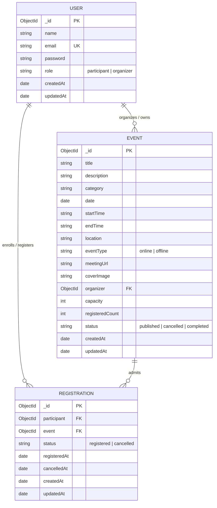

# EventHub – Database Design & Schema Specification

This document provides a comprehensive technical overview of the database architecture for the EventHub platform. EventHub uses MongoDB as its primary datastore, interfaced via Mongoose ODM (Object Data Modeling) in Node.js.

---

## 1. Architectural Overview & Design Philosophy

EventHub implements a document-oriented relational model optimized for:
1. **Low-latency event discovery** via compound and text indexes.
2. **Atomic capacity reservation** with strict guarantees against overbooking under concurrent workloads.
3. **Data integrity and auditability** preserving historical attendance records even when events or registrations are cancelled.
4. **Role-based security** with automatic password hashing and sanitization.

---

## 2. Entity-Relationship Diagram (ERD)



---

## 3. Detailed Model Specifications

### 3.1 User Model (`users` collection)

Represents both Event Participants and Event Organizers.

| Field | Type | Required | Constraints / Default | Description |
|---|---|---|---|---|
| `_id` | ObjectId | Yes | Auto-generated PK | Unique identifier |
| `name` | String | Yes | Trim, Min: 2, Max: 100 | Full name of the user |
| `email` | String | Yes | Unique, Lowercase, Trim, RFC Regex | Normalized email address |
| `password` | String | Yes | Min: 6 chars, bcrypt hash | Hashed password (10 salt rounds) |
| `role` | String | Yes | Enum: `['participant', 'organizer']`, Default: `'participant'` | Access control role |
| `createdAt` | Date | Yes | Auto timestamp | Account creation date |
| `updatedAt` | Date | Yes | Auto timestamp | Profile update date |

#### Indexes:
- `{ email: 1 }` (Unique compound index for constant-time lookup and duplicate prevention).

#### Lifecycle Methods & Hooks:
- **`pre('save')` Hook:** Automatically detects if `password` has been modified, generates a cryptographic salt via `bcrypt.genSalt(10)`, and replaces plaintext with the hash before writing to disk.
- **`comparePassword(candidatePassword)`:** Asynchronous instance method utilizing `bcrypt.compare`.
- **`toJSON()` Override:** Automatically strips the `password` property before serializing objects to HTTP responses.

---

### 3.2 Event Model (`events` collection)

Represents conferences, webinars, workshops, and meetups hosted by organizers.

| Field | Type | Required | Constraints / Default | Description |
|---|---|---|---|---|
| `_id` | ObjectId | Yes | Auto-generated PK | Unique identifier |
| `title` | String | Yes | Trim, Min: 3, Max: 150 | Title of the event |
| `description` | String | Yes | Trim, Min: 10 | Detailed agenda and syllabus |
| `category` | String | Yes | Enum: Technology, Business, Education, Workshop, Conference, Networking, Webinar, Other | Primary thematic category |
| `date` | Date | Yes | ISO 8601 Date | Scheduled calendar date |
| `startTime` | String | Yes | Trim (e.g. "09:00 AM") | Session opening time |
| `endTime` | String | Yes | Trim (e.g. "05:00 PM") | Session conclusion time |
| `location` | String | Yes | Trim | Venue address or "Online" |
| `eventType` | String | Yes | Enum: `['online', 'offline']`, Default: `'offline'` | Delivery format |
| `meetingUrl` | String | No | Trim, URL format, Default: `""` | Virtual meeting URL (protected) |
| `coverImage` | String | No | Trim, URL format, Default: `""` | Promotional card banner |
| `organizer` | ObjectId | Yes | Ref: `User`, Index: true | Event host / creator |
| `capacity` | Number | Yes | Min: 1 | Maximum allowable attendees |
| `registeredCount`| Number | Yes | Default: 0, Min: 0 | Atomically tracked seat count |
| `status` | String | Yes | Enum: `['published', 'cancelled', 'completed']`, Default: `'published'` | Lifecycle state |
| `createdAt` | Date | Yes | Auto timestamp | Creation timestamp |
| `updatedAt` | Date | Yes | Auto timestamp | Last modification timestamp |

#### Virtual Attributes:
- **`remainingSeats`:** Computed dynamically as `Math.max(0, capacity - registeredCount)`.
- **`isFull`:** Boolean flag computed dynamically as `registeredCount >= capacity`.

#### Indexes:
- `{ status: 1, date: 1 }` (Optimizes public discovery queries for upcoming active events).
- `{ category: 1, date: 1 }` (Optimizes category filtering).
- `{ organizer: 1, createdAt: -1 }` (Accelerates organizer dashboard queries).
- `{ title: 'text', description: 'text', location: 'text' }` (Full-text search engine index).

---

### 3.3 Registration Model (`registrations` collection)

Tracks participant enrollment and reservation status.

| Field | Type | Required | Constraints / Default | Description |
|---|---|---|---|---|
| `_id` | ObjectId | Yes | Auto-generated PK | Unique identifier |
| `participant` | ObjectId | Yes | Ref: `User`, Index: true | Attending user |
| `event` | ObjectId | Yes | Ref: `Event`, Index: true | Target event |
| `status` | String | Yes | Enum: `['registered', 'cancelled']`, Default: `'registered'` | Registration state |
| `registeredAt` | Date | Yes | Default: `Date.now` | Confirmation timestamp |
| `cancelledAt` | Date | No | Default: `null` | Cancellation timestamp |
| `createdAt` | Date | Yes | Auto timestamp | Record creation timestamp |
| `updatedAt` | Date | Yes | Auto timestamp | Status update timestamp |

#### Indexes:
- `{ participant: 1, event: 1 }` (**Unique Compound Index**): Guarantees at the database engine level that no participant can have more than one registration document per event.
- `{ event: 1, status: 1 }` (Used for organizer roster lookups and active attendee counts).
- `{ participant: 1, status: 1, createdAt: -1 }` (Optimizes participant dashboard lookups).

---

## 4. Concurrency & Atomic Capacity Management Strategy

### 4.1 The Overbooking Challenge
In event ticketing platforms, a common concurrency bug is the **"Time-of-Check to Time-of-Use" (TOCTOU)** race condition:
1. Two participants simultaneously check if seats are available (`count < capacity` is true for both).
2. Both participants proceed to insert a registration record.
3. The event ends up with $N + 1$ registrations, exceeding physical venue capacity.

### 4.2 EventHub's High-Concurrency Solution
Instead of relying on fragile client-side counts or multi-step read-modify-write sequences, EventHub utilizes **MongoDB Document-Level Atomic Conditional Modification**:

```javascript
// Atomically reserve seat only if registeredCount is strictly less than capacity
const updatedEvent = await Event.findOneAndUpdate(
  {
    _id: eventId,
    status: 'published',
    $expr: { $lt: ['$registeredCount', '$capacity'] }
  },
  { $inc: { registeredCount: 1 } },
  { new: true }
);

if (!updatedEvent) {
  // Rejection: Either capacity was full or status changed concurrently
  return res.status(400).json({
    success: false,
    message: 'Registration failed. Event is already at full capacity.'
  });
}
```

#### Why This Is 100% Concurrency-Safe:
1. **Document-Level Lock:** MongoDB acquires an exclusive write lock on the specific Event document.
2. **Atomic Condition:** The `$expr: { $lt: ['$registeredCount', '$capacity'] }` condition is evaluated inside the engine at the moment of modification.
3. **No Overbooking:** If 100 requests arrive concurrently for 1 remaining seat, exactly 1 request satisfies the expression and increments `registeredCount`. The other 99 requests fail immediately with null output.
4. **Standalone & Replica Set Compatibility:** This approach functions reliably on standalone MongoDB instances without requiring replica-set distributed transactions.

### 4.3 Rollback Safeguard
If saving the registration document throws an unexpected error (e.g. database network interruption), EventHub executes an atomic rollback:
```javascript
try {
  // Save or reactivate registration
  await registration.save();
} catch (error) {
  // Roll back the reserved seat atomically
  await Event.findByIdAndUpdate(eventId, { $inc: { registeredCount: -1 } });
  throw error;
}
```

### 4.4 Seat Release on Cancellation
When a participant cancels their reservation:
1. The registration record is updated with `status = 'cancelled'` and `cancelledAt = new Date()`.
2. The seat count is decremented atomically:
```javascript
await Event.findByIdAndUpdate(eventId, { $inc: { registeredCount: -1 } });
```
3. A safety guard prevents count underflow below zero:
```javascript
if (updatedEvent && updatedEvent.registeredCount < 0) {
  await Event.findByIdAndUpdate(eventId, { registeredCount: 0 });
}
```

---

## 5. Re-registration Lifecycle

Per specifications, when a participant cancels and subsequently registers again:
- The system **does not** create a duplicate document.
- The system locates the existing registration for `(participant, event)` and reactivates it:
  - `status = 'registered'`
  - `registeredAt = new Date()`
  - `cancelledAt = null`
- This preserves database hygiene while maintaining the historical timestamp integrity.
